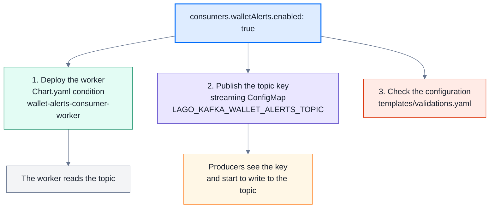
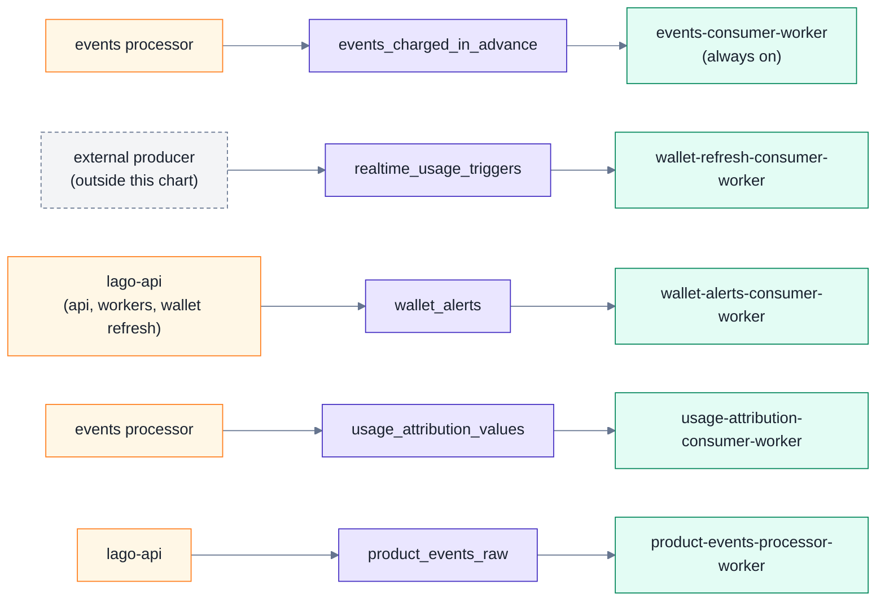

# Streaming consumers

With streaming ingestion on (`global.streaming_ingestion.enabled`), Lago reads some Kafka topics with dedicated consumers. This page explains how one value turns on a consumer, and why the chart wires it the way it does.

## The value you set

Each optional consumer has one switch:

```yaml
global:
  streaming_ingestion:
    enabled: true
    consumers:
      walletRefresh:    { enabled: true }
      walletAlerts:     { enabled: true }
      usageAttribution: { enabled: true }
      productEvents:    { enabled: true }
```

Topic names are in `global.streaming_ingestion.kafka.topics`. Change them only if your topics have other names.

## What one switch does



Colors: blue is the value you set, yellow a producer, purple a topic, green a worker, red the checks.

The switch turns on the producers and the consumer together. A producer never writes to a topic that no consumer reads.

## From producer to worker

Each row is one consumer: who writes the topic, the topic, and the worker that reads it.



| Consumer | Topic key | Karafka consumer group | Worker |
|---|---|---|---|
| `eventsChargedInAdvance` (always on) | `LAGO_KAFKA_EVENTS_CHARGED_IN_ADVANCE_TOPIC` | `lago_events_charged_in_advance_consumer` | `events-consumer-worker` |
| `walletRefresh` | `LAGO_KAFKA_REALTIME_USAGE_TRIGGERS_TOPIC` | `lago_wallet_refresh_triggers_consumer` | `wallet-refresh-consumer-worker` |
| `walletAlerts` | `LAGO_KAFKA_WALLET_ALERTS_TOPIC` | `lago_wallet_alerts_consumer` | `wallet-alerts-consumer-worker` |
| `usageAttribution` | `LAGO_KAFKA_USAGE_ATTRIBUTION_VALUES_TOPIC` | `lago_usage_attribution_values_consumer` | `usage-attribution-consumer-worker` |
| `productEvents` | `LAGO_KAFKA_PRODUCT_*_TOPIC` (3 keys) | none: Go processor, not Karafka | `product-events-processor-worker` |

## Why each part exists

| Problem | Fix in the chart |
|---|---|
| A producer writes to a topic as soon as it sees the topic key. Without a consumer, the messages pile up unread. | The topic key renders in the streaming ConfigMap only when the switch is on. |
| Every pod reads the same streaming ConfigMap, and Karafka joins the group of each topic key it sees. So every pod would join every group. | Each worker runs `karafka server --include_consumer_groups <its group>`, set by `karafka.consumer`. |
| lago-api fixes the consumer group names in its code. A wrong name reads nothing. | The group names are chart constants (`lago-config.streaming.consumers`), not values. |
| A typo, an old flag or a wrong worker can drop a consumer with no error. | `templates/validations.yaml` fails the render with a message (see [The guards](#the-guards)). |

## The three layers

| Layer | Where | Who changes it |
|---|---|---|
| Switches | `global.streaming_ingestion.consumers.<name>.enabled` | You |
| Constants: consumer, group, worker | `lago-config.streaming.consumers` in `charts/lago-config/templates/_helpers.tpl` | Chart maintainers, when lago-api adds a consumer |
| Wiring: command, topic keys, guards | `charts/lago-rails/templates/deployment.yaml`, `charts/lago-config/templates/streaming-configmap.yaml`, `charts/lago/templates/validations.yaml` | Chart maintainers |

## The guards

The render fails, with a message that names the key, in these cases:

- the consumer name is not known, the entry is not a map, or the always-on `eventsChargedInAdvance` has a switch;
- a consumer is on while `global.streaming_ingestion.enabled` is off;
- `walletRefreshConsumer` or `productEventsProcessor` (chart 2.1.4) is true, but its new key is not;
- a Karafka worker does not run its own consumer, or a consumer is named on another worker.

## Turning a consumer off

Set its `enabled` to `false`. The worker goes away and the producers stop writing to the topic. The unread messages stay in the topic. When you turn the consumer on again, it continues from its committed offset, within the topic retention. Restart the Lago pods after a change, unless Stakater Reloader watches the streaming ConfigMap.

## Adding a consumer (chart maintainers)

1. Add the consumer to `lago-config.streaming.consumers` with its Karafka group and its worker.
2. Add `consumers.<name>.enabled: false` to the umbrella and `lago-config` values, and its topic to `kafka.topics` in each chart that lists the topics.
3. Render its topic key in `streaming-configmap.yaml` when `consumerEnabled` is true.
4. Add a `lago-rails` alias to `Chart.yaml` with `condition: global.streaming_ingestion.consumers.<name>.enabled`.
5. Add a values block for the alias with `karafka.consumer: <name>`.
6. Add a test suite for the worker.
